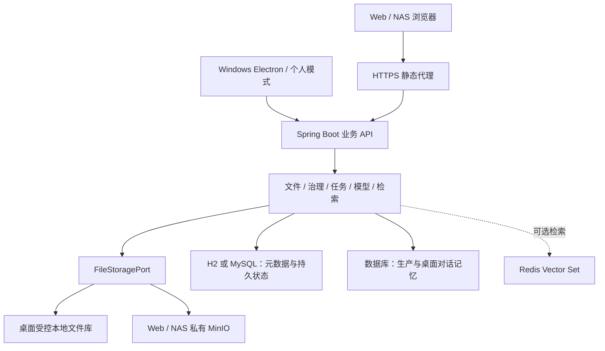

# 开发说明

更新时间：2026-10-14。本文描述当前工作区的开发边界；发布与验证状态见[进度与问题](进度与问题.md)。全部命令默认在仓库根目录执行，标明工作目录的除外。

<a id="development"></a>
## 1. 环境与版本来源

- 后端：Java 17 release、Spring Boot 3.5.13、Maven 3.9.x；具体依赖以 `backend/pom.xml` 为准。
- 前端：Vue 3、TypeScript、Element Plus、Vite；依赖及命令以 `frontend/package.json` 和锁文件为准。
- 桌面：Electron 44.7.0、electron-builder 26.15.3，包版本当前为 0.2.1；开发需 Node 22.12+。
- 捆绑 Java：`desktop/runtime.lock.json` 锁定 Temurin 21 的地址、大小与 SHA-256；最终用户使用捆绑运行时。
- Web/NAS：镜像及基础构建镜像由 `deploy/images.lock.env` 和 Dockerfile 固定，生产不使用开发机旧二进制或浮动标签。

工作区已有 H2/MySQL 两套 V47 迁移文件。它们不说明任意已安装实例都已迁移；实际版本从该实例 Flyway 历史和产物 manifest 核对。

## 2. 模块导航

- `backend/src/main/java/com/coffer/`：认证、文件生命周期、治理、解析、模型、检索、桌面和运维。
- `backend/src/main/resources/`：Profile 配置、Flyway H2/MySQL 迁移。
- `backend/src/test/`：单元、契约、集成及故障回归；`test-files/` 是测试输入，不能作为旧文档清理。
- `frontend/src/`：页面、组件、API 客户端、会话状态和桌面桥封装。
- `frontend/tests/`：浏览器任务流与接口回归。
- `desktop/src/`：启动、资源验证、loopback 代理、受控原生桥、维护生命周期。
- `desktop/scripts/`：锁定 Electron 准备、资源清单、品牌生成、交付摘要。
- `desktop/test/`：启动器安全、安装、引导、个人库、恢复等回归。
- `deploy/`：生产构建、Compose、TLS、准入、冷备份、恢复、升级、目标验收。
- `scripts/`：Windows 启动、构建、隔离验收和离线维护。
- `assets/brand/coffer.svg`：品牌矢量原稿；`desktop/build/` 为安装资源，`.build/` 才是生成目录。

后端业务边界以 `file`、`tag`、`task`、`governance`、`inbox` 为主，`auth`、`desktop`、`model/runtime`、`operations` 提供横向能力。旧顶层包仍有共享职责，增量修改时按实际依赖判断，不进行纯目录搬迁式重构。

## 3. 运行架构与数据权威



正式正文以存储适配器中的实际对象为准；数据库保存 owner、路径/键、大小、SHA-256、revision、业务状态和操作意图。派生解析、摘要、标签与索引不能替代原始正文。

`desktop` 使用 H2、本地库和数据库记忆；`prod` 使用 MySQL、私有对象存储与数据库记忆；Redis 是可重建的可选索引。开发 Profile 的 Redis 记忆路径不代表生产记忆也依赖 Redis。

桌面安装包排除服务端存储依赖，数据目录与程序目录分离。生产 Web 应用不拥有 root/迁移凭据，DDL 由一次性迁移入口完成，应用启动只做实体校验。

## 4. 身份、访问与原生桥

Web/NAS 使用服务端会话、角色和 CSRF。业务 owner 从 TenantContext 得到，后台任务必须恢复正确身份；不能信任前端过滤、不可猜 ID 或对象路径。

个人桌面由 `DesktopPersonalWorkspace` 和过滤器建立内部身份，拒绝账号管理/登录入口；共享业务仍执行文件归属和正文校验。

桌面主进程管理进程级启动令牌并注入代理请求，renderer 不持有令牌。原生文件选择/接管另有 capability，普通 HTTP 代理不透传该能力。IPC 只接受固定动作与受控句柄，不接受任意命令、宿主路径或浏览器声明的 owner。

所有文件读取通过后端鉴权；逻辑路径规范化并做 containment 检查，拒绝链接/junction 逃逸、设备名、尾随空格/点、穿越和非法字符。对象存储键归属也要核对，bucket 私有并不替代应用授权。

## 5. 写入、治理与恢复原则

1. 外部 I/O 和 SQL 不构成分布式事务；每个写入、移动、删除先保存持久意图，按阶段记录校验结果。
2. 本地适配器同卷 staging、大小/SHA-256 校验、持久化和 no-overwrite 提交；对象适配器写入/复制、校验、切换引用及延迟清理。
3. 数据库与正文未对齐不标成功；异常重启依据 durable marker、正式状态和指纹对账，不能把碰巧相同的目标内容认领为自己的操作。
4. 预览不修改正式状态；确认核对 source revision、路径、内容身份和目标快照，执行后推进 revision。
5. 幂等键相同且参数相同返回已有状态；参数不同报告冲突，不创建第二个执行者。
6. 撤销核对归档后 revision，恢复完整正式快照；后续修改、占用或指纹变化转为冲突/人工核对。
7. 旧字段、状态码和并发约束以现有实体、迁移与状态机为准，不从第一版单用户模型直接复制。

治理的正式入口为预览、确认、操作记录、撤销和补偿。旧直接分类写入路由仍返回业务冲突，标签确认不恢复旧的直接归档事件旁路。

桌面来源接管仅在元数据、导入台账及正文提交校验后执行，持久记录来源认领/删除步骤；失败保留来源。备份恢复撤销未执行外部删除授权。

工作副本保存复用正式保存意图：核对正式 revision、SHA-256、大小、mtime/身份及副本锁；提交新正文并递增版本，再重新分析/重建索引。关闭或放弃核对用户确认摘要，不以外部应用 PID 退出推断文件已保存。

## 6. 模型与检索

模型执行固定已验证的端点配置快照；运行时核对配置版本、owner 和正文。当前 Chat 不再逐文件授权；Vision/向量仍按内容风险与目标/文件版本匹配授权。

Web/NAS 向量配置由 `AdminEmbeddingService` 统一管理，凭据单独加密，普通用户只有状态与个人重建入口。端点/模型/维度变化隔离旧索引，重建临时 generation 校验后切换，不能先清空活动索引。

Hybrid 保留 FULLTEXT → LIKE 降级，向量路默认等待上限约 1500ms，以当前配置为准。删除清理和重建是持久任务，Redis 故障不丢失正文、业务记录或生产对话记忆。

模型 Key、基础设施凭据和主密钥不提交 Git。模型/业务日志不包含正文、用户内容或原始错误；异步任务用固定错误码和建议动作。

## 7. API 契约维护

只在纯 `dev` Profile 的隔离实例读取 OpenAPI；`prod`、`desktop` 关闭并拒绝调试文档。使用开发数据库，监听 loopback，避免连接生产数据。

```powershell
# 后端开发实例就绪后，在 frontend/ 执行：
npm run api:generate
npm run api:check
npm run build
```

生成源为 `http://127.0.0.1:8080/v3/api-docs`，产物为 `frontend/src/api/generated/schema.ts`。`api:check` 会重新生成并检查与 Git 的差异，当前未提交契约需先审阅，不能用“没有差异”解释为所有接口都经过实测。

DTO 经 `frontend/src/api/types.ts` 等兼容层复用生成 `components["schemas"]`；页面状态可手写，流式/multipart 请求可以封装。不要直接编辑生成文件，接口枚举或可空性变更后同步生成并编译。

少量关键协议：

- `Result.code=0` 才表示成功；新错误对应 4xx/5xx HTTP，前端仍兼容旧 HTTP 200 的非零业务错误。
- 收件箱确认提交预览中的 `targetPath`，不接受宿主来源绝对路径或自选 owner；重复完成确认幂等。
- 工作副本 close 动作为 KEEP/REPORT_EXIT/CLOSE/DISCARD，关闭/放弃附当前摘要；HTTP 成功不等于台账保存成功。
- 安装版普通访问与 native capability 分开；个人桌面免登录不取消 CSRF 或主进程桥保护。
- Web 管理员账号删除与向量配置接口以当前控制器、生成契约为准；详细字段不再在说明里手写第二份。
- 独立备份与本机快照的回执不同；整套恢复只有认证、原密钥、全表/正文与归属一致后报告 RESTORED_VERIFIED。

## 8. 构建与检查

```powershell
# 共同后端 / 服务端
mvn -f backend/pom.xml verify
# 独立桌面产物，不复用 server target/classes
mvn -f backend/pom.xml -Pdesktop package
# 前端静态资源
npm ci --prefix frontend
npm run build --prefix frontend
# 桌面锁定依赖与安全回归
npm ci --prefix desktop
npm test --prefix desktop
# Windows 完整打包
.\scripts\build-desktop.ps1 -MavenPath '<mvn.cmd>' -JavaPath '<java.exe>'
```

桌面构建通过共同 `prepare-electron.cjs` 明确准备锁定的 Electron，核对版本、Windows PE/x64 和下载校验；不依赖开发机预先存在的 dist。禁止绕过 checksum、复用未知 exe 或覆盖环境变量指定的外部分发目录。

构建输出：服务端 `backend/target/`；桌面 `backend/target/desktop/`、`desktop/.build/resources/`、`desktop/dist/`；前端 `frontend/dist/`。启动器按 manifest 校验生产资源和捆绑 Java，不使用开发机 PATH 替代。

源码交互入口为 `scripts/start-desktop-test.bat` 和 `scripts/start-desktop-backend-test.bat`；参数和测试目录见[使用与部署](使用与部署.md#source-test)。

## 9. 选择合适的回归

- 后端模块变更运行对应 Maven 测试；存储/升级变更补真实隔离文件库和故障恢复。
- 启动器安全使用 `npm test --prefix desktop`；安装/个人库/引导用 `desktop/test/` 对应 E2E。
- 页面与接口使用 `frontend/tests/`；近期账号删除、管理员向量、模型设置和下载有独立入口。
- Workbench、引导、新库和备份用隔离目录，不对真实文件库执行“首次初始化”。
- `COFFER_PLAYWRIGHT_MODULE` 可指定本机浏览器自动化模块；不要将受控 API 夹具结果登记为真实业务后端验收。
- `.github/workflows/` 保存托管构建；构建成功不关闭干净 Windows、目标 NAS、外部网络或独立介质验收。

Git 忽略目录可能保存原始证据，清理依赖/缓存前区分 `node_modules/` 与 `.test-tmp/` 的用途。历史原文与样本边界见[验收索引](验收索引.md)。

## 10. 品牌资源与维护约束

```powershell
node desktop/scripts/generate-brand-assets.cjs
```

品牌脚本读取 `assets/brand/coffer.svg`，生成共用 SVG/PNG/ICO；需要 Sharp 时可用 `COFFER_SHARP_MODULE` 指定已有模块。正常构建使用已保存资源，不要求用户安装 Sharp。

持久 schema 只由 Flyway 管理；不改写已发布迁移，不用 Hibernate 自动建表或 Flyway repair 掩盖失败 DDL。`@Async` 通过独立 Bean 调用，不传递请求结束后失效的 MultipartFile；提交后回调写库使用正确事务传播。

修改业务契约同时更新对应主题文档；实现状态只更新进度文件，测试结果只追加验收索引，不新增每轮交接/问题/验收说明。
